<p align="center"></p>

# Keepup

**Habits, together.** A warm, mobile-first habit tracker for one person, a family, and kids without a login.

**[Open Keepup](https://keepuphabits.vercel.app)** · [Try the demo](#try-it) · [Install](#how-to-install) · [How it's built](#how-its-built)

[](https://github.com/naum-4ik/keepup/actions/workflows/ci.yml)  [](LICENSE)

Check in with one tap, keep fair streaks, share habits with your family, and let kids tap in from their own view while a garden grows. It installs from the browser, sends reminders, works offline, and speaks English, Russian and Hebrew.

<p align="center">
  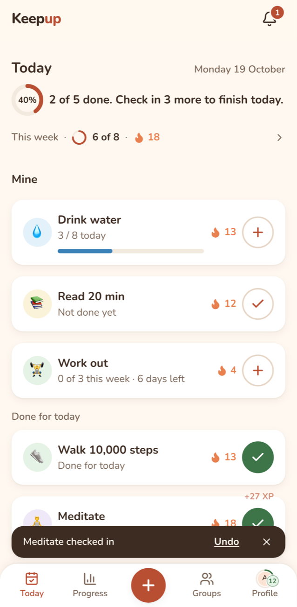
  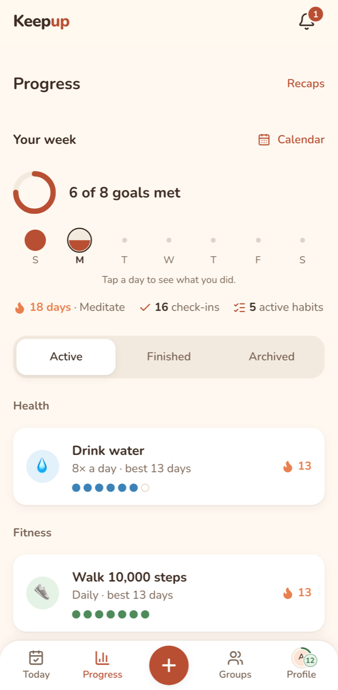
  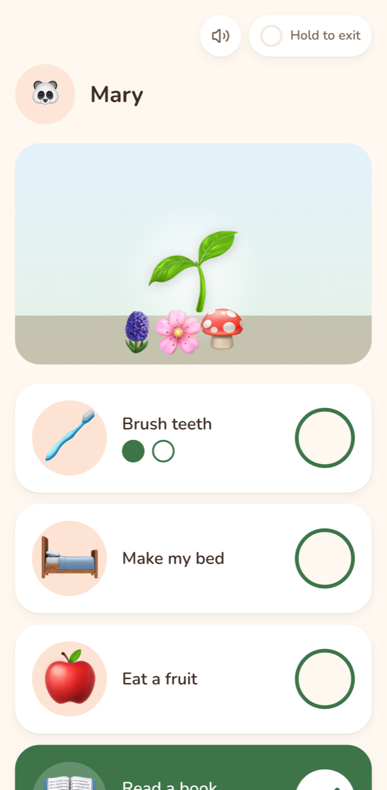
</p>

## Try it

On the first screen, **Try a demo with sample habits** opens a lived-in account with no sign-up: Sam's month of habits, a family with Alex and a kid, Nova, and an Inbox with a cheer and a nudge. It resets after 24 hours. Invites, reminders and Delete account are off in the demo.

<p align="center">
  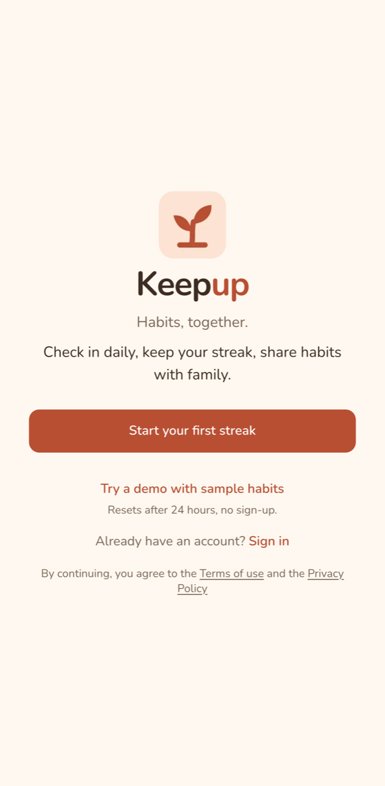
</p>

## What it does

### Every day

- **Today:** one summary line (a ring, "2 of 5 done", and what's left to finish today), then your habits with one-tap check-in, progress (`3 / 8 today`, `0 of 3 this week`) and a streak. What's left comes first, then **Done for today**, then **Later**. Group and kid habits follow in their own sections. Each check-in shows a short toast with **Undo**.
- **Ready-made habits:** 48 templates in 8 categories (Health, Fitness, Mind, Learning, People, Home, Work & money, Break a habit), or your own with any emoji. Schedules are *X times a day, week or month*, from a start date you choose.
- **Habit page:** in sections: today's check-ins with Undo, current and best streak, history, then Manage habit (reminders, an optional end such as "Day 12 of 30", pause, edit, archive or delete).
- **Fair streaks:** periods follow your time zone and week start (Sunday or Monday), a pause never breaks a streak, and a habit started mid-week doesn't count as missed.
- **Three languages:** English, Russian and Hebrew (right to left), per person. Suggested habits show in each person's language.

<p align="center">
  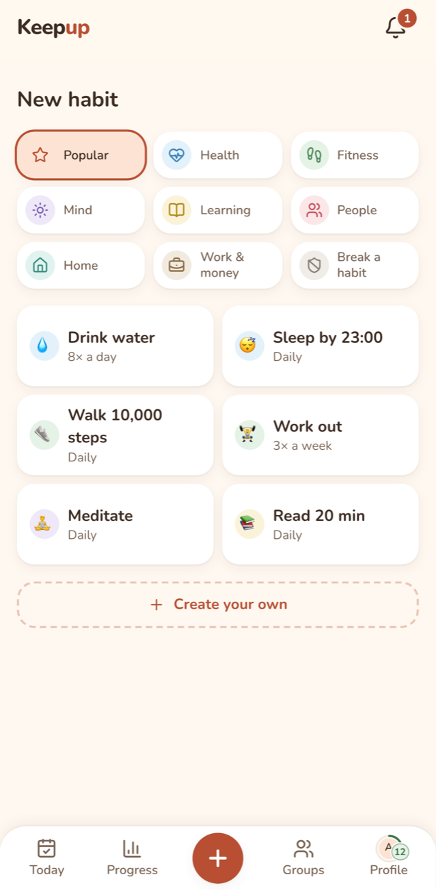
  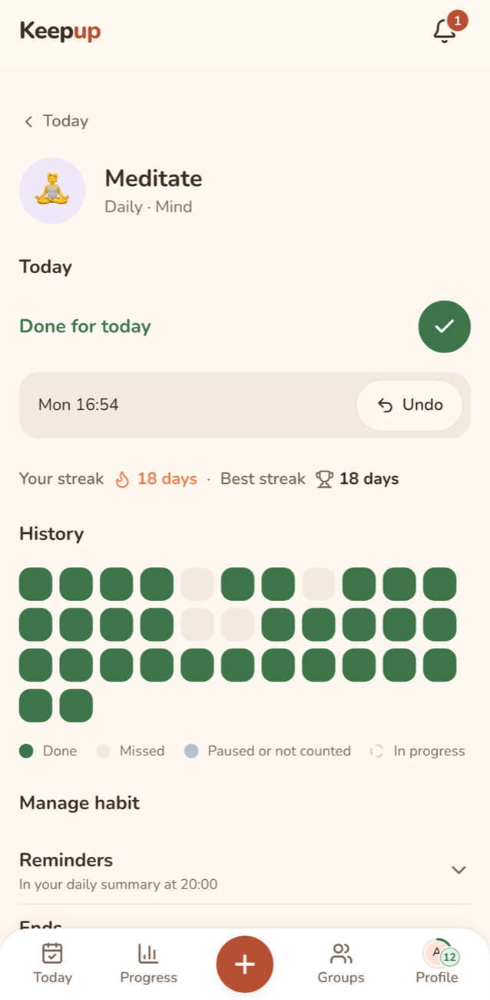
</p>

### Progress

- **Progress:** your week (tap a day to see what you did), a month-by-month calendar back to your first habit, and active, finished and archived habits by category, each with its last 7 days. Finished habits can start again.
- **Recaps:** a weekly and a monthly recap of your wins in the Inbox, with their history under Progress → Recaps.

<p align="center">
  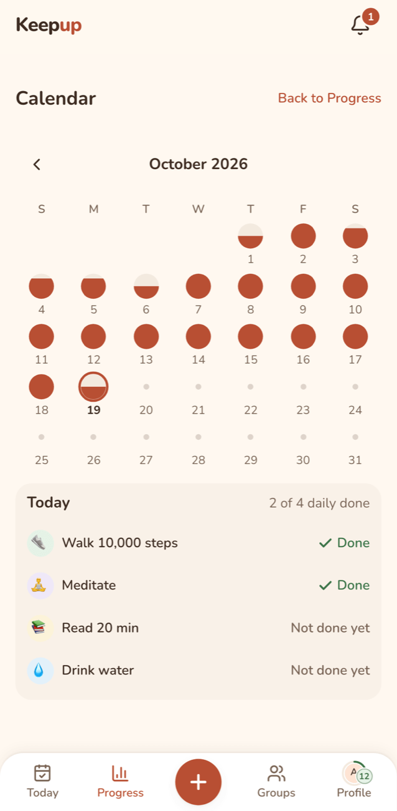
  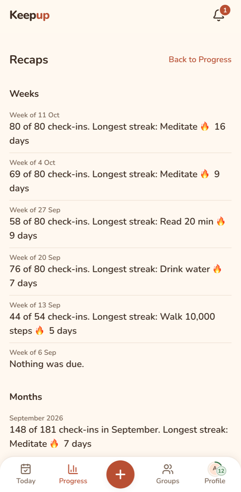
</p>

### XP, levels, badges and rest days

- **XP and levels:** a check-in earns +10, and the first one of a period grows with your streak, up to +30. Finished periods and streak milestones add more. Levels go from Seedling to Forest, with a ring around your Profile avatar.
- **Badges and milestones:** 24 badges under Profile → Achievements. Streak milestones (1, 2, 5, 7 days… 365) arrive in the Inbox, once per streak. Level-ups and badges get a short full-screen moment, or a quiet toast (Settings → Celebrations).
- **Rest days:** a week of a daily habit earns one (up to 2). A missed day uses it and the streak stays safe.

<p align="center">
  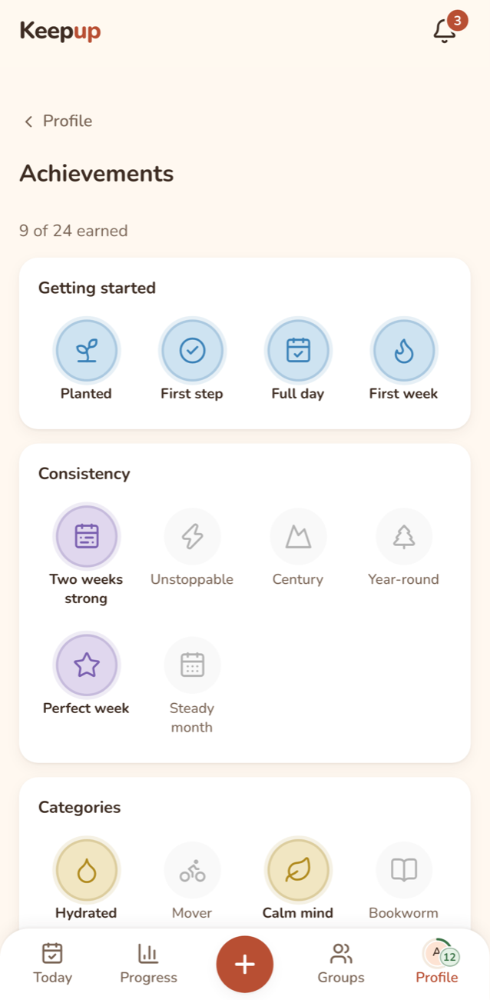
  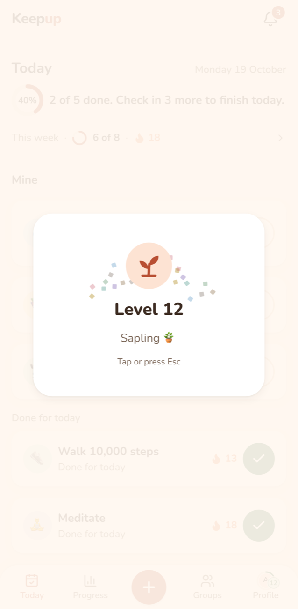
</p>

### Groups and kids

- **Groups** (family, friends, couple, roommates) with invite links and emoji avatars.
- **Habits done together:** a period is done when everyone required has checked in, with optional approval by another adult, cheers and nudges.
- **Kids without a login:** an adult checks in for them, or they tap in their own kid view. Each approved check-in is a star, and the week's stars grow a garden (or an aquarium, space, a dino egg or a town) toward a treat goal chosen with the child. Boy or girl is optional, so Russian and Hebrew can say "well done" the right way.
- **Inbox:** activity, nudges and cheers, updating live.

### On your phone

- **Installable app:** opens full screen from the Home Screen, with its own icon. No app store.
- **Reminders and pushes:** a daily summary at your hour or a habit's own time; group check-ins, approvals, nudges and kids' moments; Sound, Silent or Inbox only per kind; pause all, or mute a habit.
- **Offline:** check in without signal. The tap waits on the phone and counts for the day you tapped once you're back online. The last Today and kid view open offline.

<p align="center">
  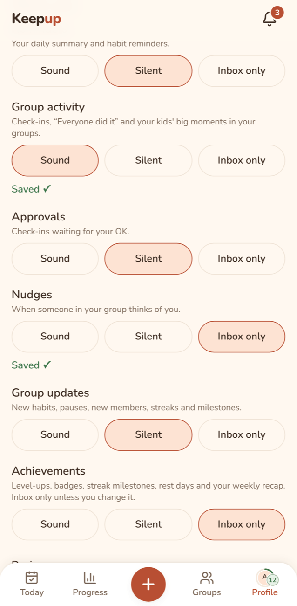
  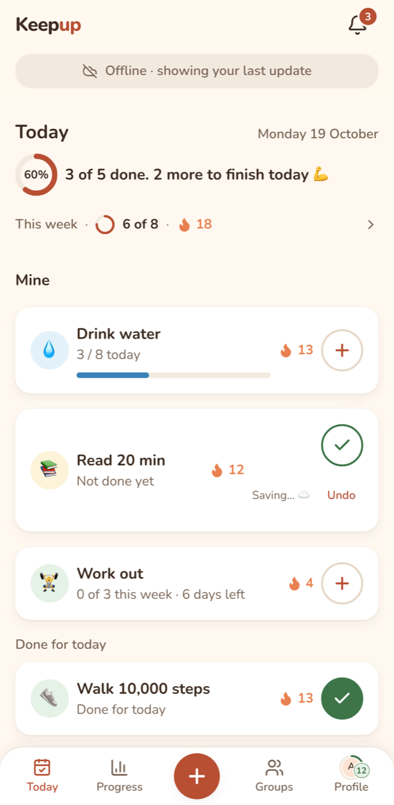
</p>

### Your data

- **Settings save as you change them** and say "Saved ✓".
- **Export my data** (a JSON file), **Reset my data** (type "reset") and **Delete account** (type "delete"; it says first which groups get a new admin and which are deleted).
- **Forgot password?** on the sign-in screen emails a reset link.
- **Private by design:** no ads and no advertising services. A child is a nickname, an emoji and a colour, with no photos or birthdates. Read the [privacy policy](https://keepuphabits.vercel.app/privacy) and the [terms of use](https://keepuphabits.vercel.app/terms).

## How to install

Keepup is a web app you add to your Home Screen: it opens full screen and can send reminders. The same steps, in the app: **[keepuphabits.vercel.app/install](https://keepuphabits.vercel.app/install)**.

### iPhone and iPad (Safari)

Open Keepup in Safari, tap **Share** (or **⋯**, then Share), tap **Add to Home Screen**, then **Add**. Open Keepup from the new icon and sign in.

<p align="center">
  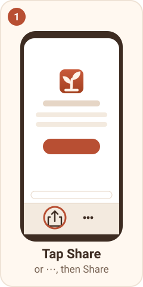
  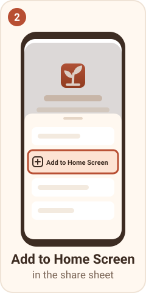
  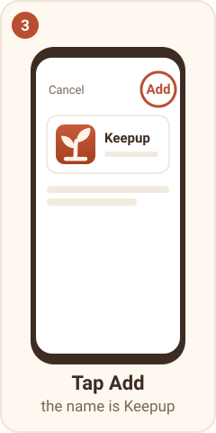
  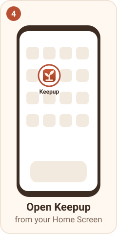
</p>

### Android (Chrome)

Open Keepup in Chrome, tap **⋮**, then **Install app** (or Add to Home screen). Open Keepup from the new icon.

<p align="center">
  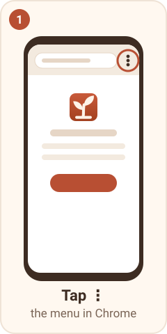
  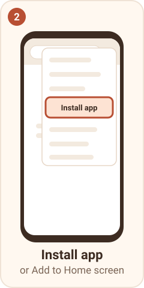
  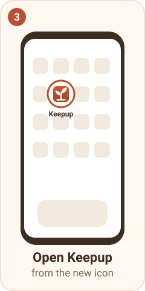
</p>

### Computer (Chrome or Edge)

Click the install icon at the right of the address bar, then **Install**.

<p align="center">
  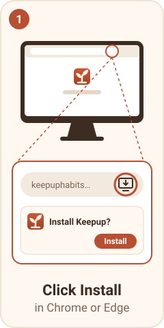
</p>

Then turn reminders on: Profile → Settings → **Turn on reminders**. Reminders belong to one install, so after reinstalling, turn them on again in Settings. The steps are also in the app: Profile, at the bottom.

Installed Keepup from the old address (keepup-murex.vercel.app)? Opening it brings you here with a short note. Install again from the new address, then delete the old icon.

## How it's built

Next.js 16 (App Router, Server Actions, next-intl) on Vercel talks to Supabase: Postgres with row-level security, Auth (Google and email + password), Realtime for the live Inbox, `pg_cron` for periods, reminders, recaps and demo cleanup, and an Edge Function that sends Web Push. The phone runs a service worker and an offline queue. GitHub Actions runs CI, deploys and keeps encrypted backups; traces go to Grafana Cloud.

More: [architecture](docs/architecture.md) (diagrams, security layers, free-tier limits, the scaling path) · [design](docs/design.md) (colours, type, spacing, motion, voice) · [decisions](docs/decisions/README.md) (27 records of the big choices and why).

## Engineering highlights

**The database is the security boundary.** Row-level security on every table (a pgTAP test fails if a table lacks it), column-level grants, and `SECURITY DEFINER` RPCs for the rules. A child is a `profiles` row with no `auth.users` entry, and adults act for them through one function, `can_act_for_profile`, that RLS and the RPCs share. Names and avatars reach the screens only through functions that check group membership first. The one function callable without signing in is the invite preview, and a test fails if there is a second.

**Who is required this period?** Periods and streaks are decided in SQL, across time zones, daylight-saving changes and each person's week start. In a group habit, an adult counts if they were a member from the start of the period, and a member pause excuses them. With approval on, a pending check-in can be reviewed until period end plus 12 hours, so a streak never flickers. All of it lives in one function, `period_outcome`, covered by pgTAP.

**Offline taps count the tap day.** Every tap gets a client-made id, so a resend after a lost response can't count twice. The server dates a queued tap by `least(tap, arrival)`, accepted up to 3 days late, so a fast clock can't push a tap into tomorrow. Even online taps go queue-first ([`lib/offline-queue.ts`](lib/offline-queue.ts), [`lib/offline-sync.ts`](lib/offline-sync.ts)).

**Push decided in the database.** A trigger on the feed table sets each row's category and `push` from the person's preferences (Pause all and mutes always win), then `pg_net` calls an Edge Function that sends one push per device. Tags let a newer push replace the older one, so on the last check-in of a group habit the family's phones buzz once, not four times. Every attempt, and every push that couldn't go out, is logged in `push_deliveries` ([push delivery log](docs/observability/README.md#push-delivery-log)).

**An XP ledger a late check-in can't fool.** XP is an append-only table with one unique key per grant, so grants are idempotent and an undo is a negative row. Period XP, milestones and badges hang off a trigger that fires when a period is settled, and again when an offline check-in upgrades it from missed to done. Milestones are keyed by the streak's first day, so they are never paid twice.

**Delete account in one transaction.** `delete_my_account()` hands admin to the longest-standing member, deletes groups left empty (with their children), then deletes the caller from `auth.users` and lets cascades take the rest, with no service-role key in the app. A read-only preview runs the same plan, so the dialog says exactly what will happen ([decision 0025](docs/decisions/0025-delete-account-is-one-database-transaction.md)).

**A demo that is a database seed.** The demo signs in anonymously and seeds a lived-in month in one transaction, dated to the visitor's day and language. Database guards keep demo and real accounts apart, and an hourly job deletes demos after 24 hours ([decision 0026](docs/decisions/0026-the-demo-is-a-database-seed.md)).

**Three languages, one catalog.** Screens, pushes and template habits come from one message catalog per language ([`supabase/functions/_shared/messages`](supabase/functions/_shared/messages)), shared by the app and the push function. Hebrew is laid out right to left, and kid lines follow the child's boy or girl setting.

**Tests at every layer:** 1541 pgTAP tests in 58 files, 2115 Vitest and 257 Playwright tests (phone viewport), plus the Edge Function tests under Deno in CI. Counts from [`scripts/count-tests.mjs`](scripts/count-tests.mjs).

## Environments

| Environment | Address | Deploys |
|---|---|---|
| Production | [keepuphabits.vercel.app](https://keepuphabits.vercel.app) | Vercel project `keepup-prod`, Supabase production. Only on a release (merge to `main`): database migrations, then the push function, then the app. A failed step stops the rest. A docs-only merge to `main` doesn't redeploy |
| Staging | [keepup-stage.vercel.app](https://keepup-stage.vercel.app) | Vercel project `keepup-stage`, Supabase staging. Every merge to `develop`; migrations go out after CI's database tests pass |
| PR previews | a Vercel preview link per PR | The app only, on staging data |

- **Flow:** `feature/*` → PR (squash) → `develop` (staging) → release PR → `main` (production), merged with a merge commit only (a `main` ruleset), so both branches share one history. release-please writes the versions and the changelog.
- **CI:** PR checks take about 2.5 minutes: lint, types, unit and Edge Function tests (required), plus one sanity e2e test through a real database. A merge to `develop` or `main` also runs pgTAP, which gates the staging database deploy, and after each merge to `develop` the full Playwright suite runs on its own ([decision 0024](docs/decisions/0024-pr-checks-in-a-minute.md)).
- **Backups:** staging and production are dumped nightly (schema, data and logins), encrypted with `age`, and a monthly job restores the latest into a throwaway database and checks it.

## Observability


The server sends OpenTelemetry traces and events (one wide event per action, linked to its trace) straight to Grafana Cloud's free tier, with no collector. The browser sends its errors and speed measurements through Grafana Faro (on in staging and production). Passwords, tokens and keys are masked before export, and a unit test fails if one gets through. Alerts email on new arrivals, production errors and silent telemetry, and an uptime check with an SLO watches from outside.

What is sent, the queries, the alerts, the push delivery log, a real incident and a staged one ([postmortem 001](docs/observability/postmortems/001-production-telemetry-silent.md)): [docs/observability](docs/observability/README.md).

## Run locally

Requires Node 24+ and Docker.

```bash
git clone https://github.com/naum-4ik/keepup && cd keepup
npm install
npx supabase start          # local Postgres, Auth, Studio (:54323), Mailpit (:54324)
node scripts/local-env.mjs  # writes .env.local
npm run dev                 # http://localhost:3000
```

Tests: `npm test` (Vitest) · `npx supabase test db` (pgTAP) · `npm run e2e` (Playwright) · `npm run test:functions` (Deno) · counts: `node scripts/count-tests.mjs`

README screenshots: `npm run readme:screenshots` (local stack; seeds a demo month, macOS `sips` resizes).

## Roadmap

| Release | What | Status |
|---|---|---|
| M1 | Foundation: auth (Google, email and password), profiles, CI, staging deploys, versioning | ✅ v0.2.0 |
| M2 | Private habits: templates, check-ins, streaks, pauses, habit page, progress, weekly overview, onboarding | ✅ v0.3.0 |
| M3 | Groups and family: shared habits, approvals, kid profiles with a star garden, emoji avatars, backups | ✅ v0.4.0 |
| M4 | Installable app (PWA), push reminders, offline check-ins | ✅ v0.5.0 |
| M5 | XP, levels, badges, rest days, weekly recaps | ✅ v0.6.0 |
| M6 | Landing page, the demo, privacy policy, data export and account delete, production | ✅ v1.0.0 |
| v1.1 | Its own address (keepuphabits.vercel.app), a "Keepup moved" note on the old one, an in-app How to install guide | ✅ v1.1.0 |
| v1.2–1.4 | Grafana dashboards and alerts, fixes from the production test, the demo on sign-in and sign-up, Keepup-branded auth emails | ✅ v1.4.0 |
| v1.5 | English, Russian and Hebrew (right to left), template habits in each person's language, kid boy or girl | ✅ v1.5.0 |
| v1.6 | The demo looks live on any day and in the visitor's language; a log of every push attempt | ✅ v1.6.0 |
| v1.7 | Terms of use | ✅ v1.7.0 |
| v1.8 | Design pass: fewer boxes, even spacing, a toast with Undo after every action, settings that save on change, a start page with one button | ✅ v1.8.0 |

Next (merged, not yet released): `sitemap.xml`, a real 404 page, and installed-app icons for the macOS app grid.

## How it was built

Built with Claude Code as a pair programmer. I wrote the spec, made the product and architecture decisions, and reviewed and merged every feature PR; tests and CI gate every code change.

License: [MIT](LICENSE).
