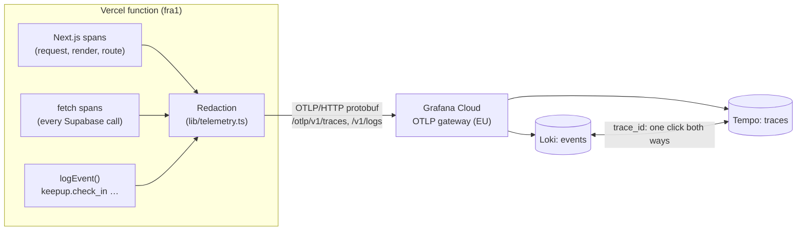
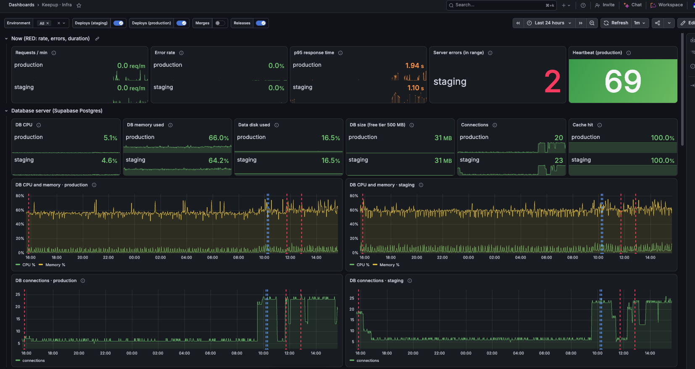
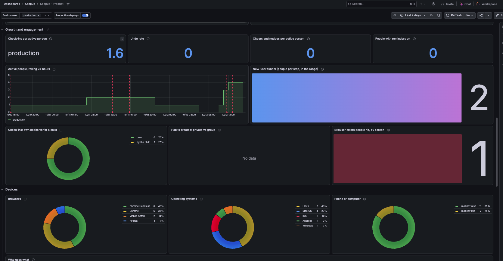

# Observability

Keepup on Vercel sends traces and events to **Grafana Cloud** (free tier) over **OpenTelemetry**. No collector, no agent, no paid plan: the app exports OTLP straight to Grafana's gateway, and switching vendors means changing two environment variables.



## What is sent
- **Traces** for every request, server action, render and Supabase call (`@vercel/otel` traces `fetch`, which supabase-js uses). Each trace carries `user.id` and `user.email` (from the session's JWT claims, no extra query); check-in taps add `habit.id` and `child.id`.
- **Events** (OpenTelemetry logs): one wide event per meaningful action, with the trace it happened in: `track()` in `lib/log.ts` (`keepup.habit_created`, `keepup.invite_accepted`, `keepup.account_deleted` …), and `keepup.error` (level ERROR, the trace turns red) for every unexpected server failure. The richest is `keepup.check_in`, with who, which habit (title, category), for which child, the outcome (`saved`, `refused` with the rule's code, `failed` with the error) and the XP. The habit and child names are read **after the response** (`after()`), so a tap never waits for its telemetry.
- **Labels:** `service.name=keepup`, `deployment.environment.name` = `production` (Vercel project `keepup-prod`, keepuphabits.vercel.app), `staging` (`keepup-stage`), `preview` or `local` (`OTEL_RESOURCE_ATTRIBUTES`).
- **Browser** (Grafana Faro, `components/observability/faro.tsx`): page errors, console errors and warnings, Web Vitals, views and request traces that continue on the server. On only where `NEXT_PUBLIC_FARO_URL` is set; it loads after the page is up and is cleaned by `lib/redact.ts` before sending.

Events, not clicks: a click says what was pressed; an event says what happened and whether it worked.

## What is never sent
Secrets: the sign-in `code`, `token` / `access_token` / `refresh_token` parameters, `authorization` / `cookie` / `apikey` values, JWTs, Grafana (`glc_`) and Supabase (`sb_secret_`) keys. `lib/telemetry.ts` masks them in span names, attributes, events and log records **before export** (the browser uses the same rules from `lib/redact.ts`), and `lib/telemetry.test.ts` and `lib/redact.test.ts` fail if any of them gets through. CI runs it on every PR.

## Design notes (and the traps behind them)
- **One explicit export path, never `"auto"`.** With `OTEL_EXPORTER_OTLP_ENDPOINT` set, `@vercel/otel` adds its own exporter even when you pass a custom one, so every span went out twice: once redacted, once not. Found by counting requests on a local OTLP server, not by reading the config.
- **Flush logs yourself.** `@vercel/otel` flushes spans when a request ends, not logs; a frozen function would drop them. `flushLogs()` runs at the end of each `after()` callback.
- **No endpoint, no export.** Dev and CI send nothing (no retry noise to `localhost:4318`).
- **Sampling:** 100%. At family scale the free tier (50 GB of traces and 50 GB of logs a month, 14-day retention) is out of reach; `OTEL_TRACES_SAMPLER_ARG` lowers it without a deploy of new code.

## Incident: the silent 404 (2026-10-07)
After the tracing PR merged, staging sent nothing, while local dev worked.
1. Deploy confirmed; no traces under any label (only `local`).
2. The OTel SDK's own warning ("Inconsistent start and end time") in Vercel's logs proved the SDK ran on Vercel, so spans were made and lost on the way out.
3. `OTEL_LOG_LEVEL=debug` + redeploy: `@vercel/otel/otlp: onSuccess 404 Not Found`. A routing error, **reported as success**.
4. The endpoint variable was re-entered as `https://otlp-gateway-prod-eu-west-2.grafana.net/otlp`, redeployed: `200 OK`, traces arrived.

Lessons: `@vercel/otel` 2.1.3 reports 401 and 404 as success, so an app can't notice its telemetry is gone. An alert on **"no traces from production for 30 minutes"** now watches the pipeline from the other end; a staged repeat of this failure was caught in 32 minutes ([postmortem 001](postmortems/001-production-telemetry-silent.md)). Environment variable edits only reach a deployment built after them.

## Alerts
Grafana-managed rules in the `Keepup` folder, emailed to the owner:
| Rule | Fires when | Query |
|---|---|---|
| Someone new arrived | a sign-up or a demo start on production; one email each, with email or demo id, IP, city and country | Loki: `keepup.signed_up`, `keepup.demo_started` |
| Production errors | more than 2 server errors in 15 minutes (a count, not a rate: at low traffic one error is 50%) | `sum(increase(traces_spanmetrics_calls_total{service="keepup", deployment_environment="production", status_code="STATUS_CODE_ERROR"}[15m])) > 2` |
| Production telemetry silent | fewer than 1 span in 30 minutes, or no data | `sum(increase(traces_spanmetrics_calls_total{service="keepup", deployment_environment="production"}[30m])) < 1` |
| Uptime check `keepup-prod-api` + SLO | `GET /api/celebrations` stops answering 401 (2 failures in 15 minutes, from Frankfurt every 5 minutes); SLO 99.5% reachability over 28 days with burn-rate alerts | Synthetic Monitoring |

The uptime check is also the heartbeat: it keeps production traffic above zero, so "silent" means broken, not idle.

## Dashboards


[`dashboards/keepup-infra.json`](dashboards/keepup-infra.json) (Grafana → Dashboards → Import; pick the Prometheus and Loki data sources). Staging and production side by side, no filter needed (an Environment dropdown narrows it):
- **Now (RED):** requests per minute, error rate, p95 response time and server errors, one value per environment, and a production **Heartbeat** (spans in the last 30 minutes, red `SILENT` at 0). Error rate and p95 show "No traffic" instead of a green 0 when nothing arrives ([postmortem 001](postmortems/001-production-telemetry-silent.md)).
- **Database server:** CPU (busy ÷ total), memory, the `/data` disk, database size against the free tier's 500 MB, connections and cache hit, from Supabase's metrics endpoint (Grafana's Supabase integration, scrape jobs `supabase_staging` and `supabase_production`).
- **Per page** and **database calls:** rate, errors and p95 per route or PostgREST call, from Grafana's span metrics (`traces_spanmetrics_*`). Span names are short on purpose (`fetch GET /rest/v1/check_ins`): one series per name.
- **Latest errors:** `keepup.error` lines, each linked to its trace.
- **Markers:** staging and production deploys and releases from `keepup-ci` events (merges are off by default).



[`dashboards/keepup-product.json`](dashboards/keepup-product.json): production by default (staging is mostly tests).
- **What happened** (top; default the last 2 days, so a Monday look covers the weekend): new arrivals (sign-ups and demo starts) and sign-ins with IP, city and country (`lib/geo.ts`, from Vercel's `x-vercel-ip-*` and `x-real-ip` headers), every action as a timeline, browser visits also before sign-in, arrivals by country. Demo visitors show as `demo · ` and the start of their user id.
- **People:** active people, visits, sign-ins and sign-ups (by method), demo visits, check-ins; activity per person.
- **Growth and engagement:** daily active people, the new-user funnel, check-ins per active person, undo rate, cheers and nudges per person, reminders on, own vs a child's check-ins, private vs group habits, browser errors by screen.
- **Devices** and **Screens** (Faro): browsers, systems, phone or computer, who uses what, most viewed screens.
- **Habits**, **Features and friction**, **Live feed**: top habits, categories, the habit lifecycle, feature use, refusals by rule, the latest actions as readable lines.
Infra also has **Limits**: database size against 500 MB, connections against 60 (the free plan's Nano compute), the data disk and memory, plus links to the monthly quotas the metrics feed doesn't carry.

## Queries
TraceQL (Tempo):
```
{ resource.deployment.environment.name = "production" && span.user.email = "anna@example.com" }
{ resource.service.name = "keepup" && name =~ ".*check-ins/tap.*" }
```
LogQL (Loki; attribute dots become underscores):
```
{service_name="keepup"} | event_name="keepup.check_in" | check_in_outcome="refused"
sum by (habit_title) (count_over_time({service_name="keepup"} | event_name="keepup.check_in" [1h]))
```
From a trace to the database: `user.id` is `auth.users.id` and `profiles.id`; `habit.id` is `habits.id`.

## Configuration (Vercel)
| Variable | Value |
|---|---|
| `OTEL_EXPORTER_OTLP_ENDPOINT` | `https://otlp-gateway-<region>.grafana.net/otlp` (no trailing slash, no `/v1/traces`) |
| `OTEL_EXPORTER_OTLP_HEADERS` | `Authorization=Basic%20<base64(instanceId:token)>`, Sensitive |
| `OTEL_RESOURCE_ATTRIBUTES` | `deployment.environment.name=production` (`keepup-prod`), `=staging` (`keepup-stage` Production), `=preview` (Preview) |
| `NEXT_PUBLIC_FARO_URL` | the Faro collector URL; unset = no browser reporting |
| `NEXT_PUBLIC_DEPLOY_ENV` | the browser's environment label, same values as above |
| `OTEL_LOG_LEVEL` | `warn`; `debug` to see export results |

Changing a production variable: redeploy through the Release workflow, so the change leaves a `keepup.deployed` marker on the dashboards. A redeploy from the Vercel dashboard leaves none; then add one by hand: `scripts/change-event.sh keepup.deployed deploy.env=production deploy.state=success` ([postmortem 001](postmortems/001-production-telemetry-silent.md), action 2).
